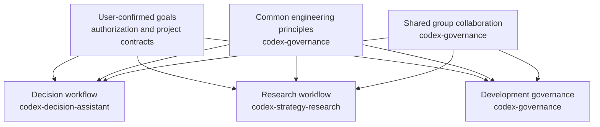
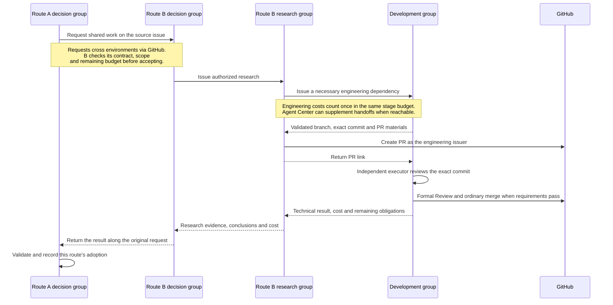

# Codex Decision and Three-Group Collaboration

English | [简体中文](README.zh-CN.md)

`codex-decision-assistant` advances a project from the first principles of its business goal. It starts with the outcome, success criteria, and hard constraints confirmed by the user. It then recovers the route's contribution, stage deliverables, authorization, budget, and bottlenecks, and coordinates research, development, and other route decision groups. The Skill starts only when explicitly invoked. Before issuing tasks, every 900 seconds, and when difficulties or stage results arrive, it checks whether the work can produce verifiable results that support the business goal.

If the goal or a necessary trade-off remains unclear after reading existing records, the decision group must ask the user for clarification. It must bring dependent work and resource use to a safe stopping point. When the goal is clear but the technical method is unknown, it validates the method within existing authorization. A route or task list cannot replace the business goal. Passing tests or finishing an experiment alone does not prove business progress; reliable negative results can inform the direction.

Within its authorization, the decision group can reorder work, pause ineffective repetition, draw conclusions from existing evidence, or arrange tests that distinguish competing explanations. Major changes to goals, acceptance criteria, or approved approaches require immediate user approval. So do budget overruns, the same action exceeding 24 hours, fork/flush, and matters reserved by the original contract. Failure history, budget use, and stop conditions carry across tasks and sessions.

The sole shared definition of the three groups' responsibilities is `governance/group-collaboration.md` in the governance source. All development roles use one development account; research and decision groups each use their own account. Real accounts and directories remain in each group's private bindings. Research can directly issue necessary engineering dependencies within its current authorization, and results return directly to research. The actual issuing group creates the PR. Development maintains it, performs independent review, submits formal approval, completes an ordinary merge, and closes out the work.

Each route has one decision group. Logical participants, roles, and runtime environments are declared separately. Across environments, groups collaborate through comments on the source GitHub task and cross-references from route entry points. Agent Center provides immediate handoffs when the target environment is accessible. Each shared task has one lead route, while each consumer route decides whether to adopt the result. The original requester, shared-record maintainer, and actual engineering issuer retain their own responsibilities. An offline group processes records when it next starts; silence means neither acceptance nor stopped work.

## Rule relationships

Arrows show which sources constrain each workflow. User authorization and project contracts bound all three workflows; each retains its own activation rules, writable scope, review, and completion conditions.



[codex-governance](https://github.com/slowchillchill/codex-governance) owns the common `governance/engineering-principles.md`, the sole cross-group rules in `governance/group-collaboration.md`, and the development lifecycle in `governance/codex-development-governance.md`. [codex-strategy-research](https://github.com/slowchillchill/codex-strategy-research) owns `research/research-workflow.md`, including research methods, data use, evidence, and independent research review. This repository owns [the decision workflow](decision/decision-workflow.md): business-goal recovery, prioritization, task issuance, supervision, and course correction within authorization.

## Collaboration flow

This example follows a shared dependency requested by route A and issued to development by route B's research group. The original cross-route request and the engineering task keep separate issuers and return paths.



Decision groups can also issue engineering tasks directly. The actual engineering issuer creates the PR and receives the technical result. Research judges research evidence; development performs technical review and delivery; decision groups judge progress against the business goal. Each consumer route confirms its own adoption of a shared result.

## Repository guide

| Path | Purpose |
| --- | --- |
| [Skill](skills/codex-decision-assistant/SKILL.md) | Explicit invocation, rule discovery, and required boundaries |
| [Decision procedure](decision/decision-workflow.md) | Recover goals, supervise, correct course, issue tasks, and check results |
| [Single adapter](scripts/agent_center.py) | Select GitHub or Agent Center by participant and paginate records and execution evidence |
| [Cross-route protocol](docs/cross-route-protocol.md) | Source-task messages, acceptance decisions, results, and recovery across environments |
| [Project reference](docs/projects/btc-updown-marketmaker.md) | Recover A/B/C entry points and shared-record responsibilities when this project is explicitly selected |
| [Configuration templates](templates/) | Placeholder examples for private decision identity, participant, and channel bindings |
| [Installation](docs/installation.md) | Complete sources, identity migration, and enablement steps |
| [Validation](evaluations/validation.md) | Scope and results of local protocol tests and independent behavior evaluations |

## Installation

Use Python 3.11+, Git, and Codex CLI. The GitHub collaboration channel also needs GitHub CLI (`gh`). Keep a compatible, complete [codex-governance](https://github.com/slowchillchill/codex-governance) checkout for shared rules and the identity script; research coordination also needs [codex-strategy-research](https://github.com/slowchillchill/codex-strategy-research) and its installed Skill and roles.

Clone the complete source and register the decision Skill in the user-level discovery directory:

```bash
git clone https://github.com/slowchillchill/codex-decision-assistant.git
cd codex-decision-assistant
mkdir -p "$HOME/.agents/skills"
ln -s "$(pwd)/skills/codex-decision-assistant" \
  "$HOME/.agents/skills/codex-decision-assistant"
```

Keep the complete checkout: the Skill follows relative links to the decision procedure, protocol, and adapter. If the destination already exists, inspect it before changing it. This user-level entry is shared by Codex profiles running under the same OS user.

Before using real collaboration, follow [the installation guide](docs/installation.md) to prepare private bindings from [the templates](templates/): the governance source and each group's own GitHub identity, then the exact participants and route entry points. GitHub-only targets need no remote App Server; the optional Agent Center channel needs an accessible existing App Server, an exact thread, working directory, and Skill path. Keep real accounts, paths, credentials, and thread bindings outside repositories.

Codex normally detects installed Skills automatically. If it does not appear in the selector, restart the CLI. Then invoke the Skill explicitly with a concrete stage request. Installation makes the Skill discoverable; project authorization and execution bindings govern actual work. See [the official discovery documentation](https://learn.chatgpt.com/docs/build-skills).

## Usage

After starting a normal session, select this Skill in the client and provide a specific stage request:

```text
$codex-decision-assistant
Advance the approved stage for this route in the current project. First recover the user-confirmed goal, success criteria, hard constraints, exact Issues, designated Project, budget, and bottlenecks.
Ask me to clarify any unclear goal or necessary trade-off. Recover cross-route requests, shared changes, and applicable results from existing GitHub records.
Directly issue research or development tasks within authorization. Supervise and correct course during the current execution turn. Report user-reserved matters immediately.
```

Tasks, progress, and decisions stay in the project's existing Issues, Projects, and decision records. No local task ledger is created. Supervision runs only during the current execution turn and ends with the final reply; no background service is installed. Development handles business source code. Research writes only to its assigned directories outside the business repository.

## Validation

Local validation uses the Python 3.11+ standard library and simulated CLIs. It does not connect to real accounts or threads:

```bash
python3 -m unittest discover -s tests -v
```

By default, cross-repository identity tests read the identity script from the adjacent `codex-governance` checkout. For other layouts, set the test variable `GOVERNANCE_SOURCE_ROOT`. Real permissions, collaborator invitations, thread bindings, and live integration are completed during enablement. Local simulations do not prove that these conditions are ready.

## License

This repository is licensed under the [MIT License](LICENSE). Referenced repositories retain their own licenses.
