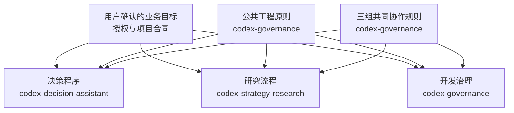
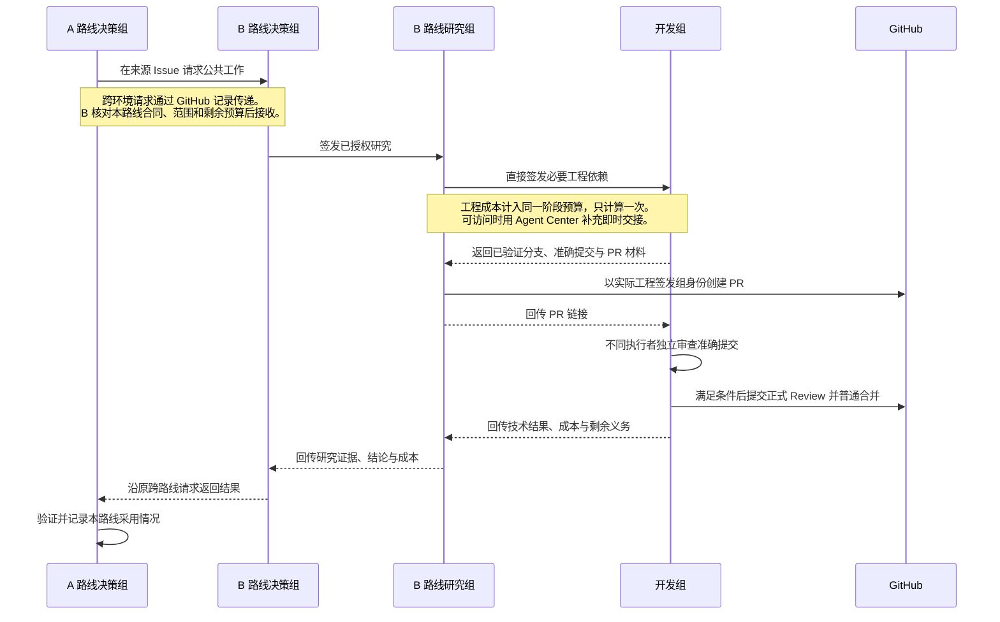

# Codex 决策与三组协作

[English](README.md) | 简体中文

`codex-decision-assistant` 以项目业务目标的第一性原则推进工作：从用户确认的最终结果、成功标准和硬约束出发，恢复本路线贡献、阶段成果、授权、预算和瓶颈，协调研究组、开发组与其他路线决策组。只有显式调用才启动；签发前、每 900 秒及收到困难或阶段结果时，检查工作能否产生支持业务目标的可核验结果。

回读现有记录后，目标或必要取舍仍不清晰时，决策组必须要求用户补充，并把依赖答案的工作和资源消费停在安全点。目标明确而技术方法未知时，在授权内验证。现有路线和任务清单不能代替业务目标，测试通过或实验结束不能单独证明业务进展；可靠负面结果可以支持方向判断。

决策组可以调整授权内顺序、暂停无效重复、组织已有证据形成结论或安排辨别验证。重大目标、验收或已批准方案变化、预算超支、同一动作超过 24 小时、fork／flush 及原合同保留事项立即交用户批准。失败历史、预算消耗和停止条件跨任务与会话延续。

三组职责的唯一公共正文在治理源的 `governance/group-collaboration.md`。开发组全部角色用同一个开发账号，研究组与决策组各用自己的账号；真实账号及目录保存在各组私有绑定。研究可直接签发当前授权内必要工程依赖，结果直接回研究组。PR 由实际签发组创建，开发组维护、独立审查、正式批准、普通合并并收尾。

每条路线由一个决策组负责，逻辑参与者、职责和运行环境分别声明。跨环境通过 GitHub 来源任务评论和路线入口交叉引用协作，可访问环境再使用 Agent Center 即时交接。公共任务只有一个主责路线，各路线分别判断是否采用；最初请求方、公共记录维护者和实际工程签发组各保留自己的责任。离线组下次启动时处理记录，沉默不表示接受或停工。

## 规则关系

箭头表示哪些依据约束各工作流。用户授权和项目合同约束全部三个流程；每个流程分别保留自己的启用条件、可写范围、审查和完成条件。



[codex-governance](https://github.com/slowchillchill/codex-governance) 维护公共工程原则 `governance/engineering-principles.md`、跨组协作的唯一正文 `governance/group-collaboration.md`，以及工程闭环 `governance/codex-development-governance.md`。[codex-strategy-research](https://github.com/slowchillchill/codex-strategy-research) 维护 `research/research-workflow.md`，负责研究方法、数据用途、证据及独立研究审查。本仓库维护[决策程序](decision/decision-workflow.md)，负责恢复业务目标，在授权内安排优先级、签发、监督及纠偏。

## 协作流程

下面以 A 路线请求公共能力、B 路线研究组签发必要工程依赖为例。原跨路线请求与具体工程任务分别保留签发来源及回传关系。



决策组也可直接签发工程任务。实际工程签发组创建 PR 并接收技术结果；研究组判断研究证据，开发组完成技术审查与交付，决策组判断工作对业务目标的贡献。各消费路线分别确认是否采用公共成果。

## 仓库导航

| 路径 | 用途 |
| --- | --- |
| [Skill](skills/codex-decision-assistant/SKILL.md) | 显式启动、规则定位与必要边界 |
| [决策程序](decision/decision-workflow.md) | 恢复目标、监督判断、纠偏、签发和结果检查 |
| [单一适配器](scripts/agent_center.py) | 按参与者选择 GitHub 或 Agent Center，分页发现记录与执行证据 |
| [跨路线协议](docs/cross-route-protocol.md) | 来源任务消息、接收决定、结果与跨环境恢复 |
| [项目参考](docs/projects/btc-updown-marketmaker.md) | 明确选用该项目时恢复 A/B/C 入口及公共记录维护分工 |
| [配置模板](templates/) | 决策身份、参与者与通道私有绑定的占位示例 |
| [安装说明](docs/installation.md) | 完整源、身份迁移及启用步骤 |
| [验证](evaluations/validation.md) | 本地协议测试及独立行为验收的范围与结果 |

## 安装

准备 Python 3.11+、Git 和 Codex CLI。GitHub 协作通道还需要 GitHub CLI（`gh`）。保留兼容且完整的 [codex-governance](https://github.com/slowchillchill/codex-governance) 工作树，用于公共规则与身份脚本；使用研究协作时，还需 [codex-strategy-research](https://github.com/slowchillchill/codex-strategy-research) 及其已安装的 Skill 和角色。

克隆完整源码，并将决策 Skill 注册到用户级发现目录：

```bash
git clone https://github.com/slowchillchill/codex-decision-assistant.git
cd codex-decision-assistant
mkdir -p "$HOME/.agents/skills"
ln -s "$(pwd)/skills/codex-decision-assistant" \
  "$HOME/.agents/skills/codex-decision-assistant"
```

保留整个工作树，Skill 会通过相对链接读取决策程序、协议和适配器。目标入口已存在时，先检查其内容再调整。同一系统用户下的多个 Codex 配置共用这个用户级入口。

实际协作前，按[安装说明](docs/installation.md)从[模板](templates/)准备仓库外私有绑定：先指定治理源及各组独立 GitHub 身份，再填写准确参与者和路线入口。纯 GitHub 目标无需远端 App Server；可选的 Agent Center 通道需要已可访问的 App Server、准确线程、工作目录和 Skill 路径。真实账号、路径、认证材料和线程绑定保存在仓库外。

Codex 通常会自动发现已安装的 Skill；若技能选择列表尚未出现，再重新进入 CLI。之后显式调用 Skill 并给出准确阶段请求。安装让 CLI 能发现 Skill，实际工作仍按项目授权和执行绑定开展。发现规则见 [OpenAI 官方文档](https://learn.chatgpt.com/docs/build-skills)。

## 使用

普通启动后从客户端选择本 Skill，再提交具体阶段请求：

```text
$codex-decision-assistant
推进当前项目本路线已批准阶段。先恢复用户确认的目标、成功标准、硬约束、准确 Issues、指定 Project、预算和瓶颈。
目标或必要取舍不清时要求我补充；跨路线从现有 GitHub 记录恢复请求、公共变化和适用成果。
按授权直接签发研究或开发，在当前执行轮次内监督并纠偏。遇到用户保留事项立即汇报。
```

任务、进度和决定沿用项目现有 Issues、Projects 与裁决入口，不建立本地任务账本。监督只在当前执行轮次运行，最终回复后结束；不安装后台服务。业务源码交开发组，研究只写分配的仓库外目录。

## 验证

本地验证使用 Python 3.11+ 标准库及模拟 CLI，不连接真实账号或线程：

```bash
python3 -m unittest discover -s tests -v
```

跨仓库身份测试默认读取相邻 `codex-governance` 的身份脚本；其他布局设置测试变量 `GOVERNANCE_SOURCE_ROOT`。真实权限、协作邀请、线程绑定和真实联调在启用阶段完成，本地模拟不证明这些条件已就绪。

## 许可证

本仓库采用 [MIT 许可证](LICENSE)。引用的其他仓库沿用各自的许可证。
